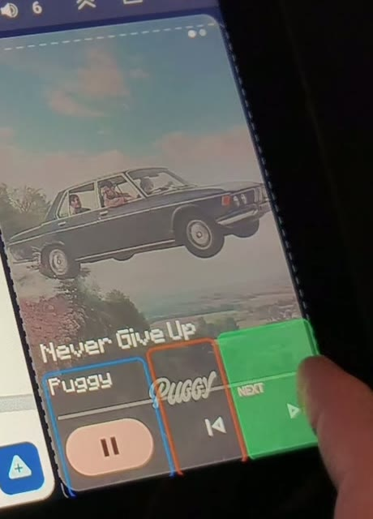
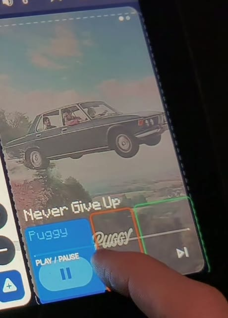
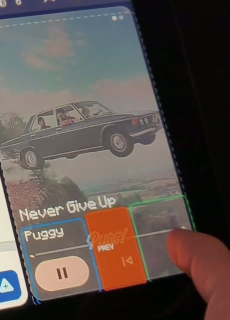

# AA Next

**Big, forgiving media buttons for Android Auto on aftermarket Android head units running ZLINK.**

In the Android Auto split screen (e.g. Waze + Spotify), the media card's Next button is small. Miss it and the tap lands on the card, Android Auto switches to full-screen Spotify. That's annoying and distracting while driving.

AA Next is a small app for the **head unit** (not the phone). It puts an invisible panel over the media card:

- a **large NEXT zone** that you can size however you like;
- optional **PLAY / PAUSE** and **PREV** zones;
- a **guard area**: every other tap on the card is swallowed, so a near miss can never open Spotify full screen.

Your normal Android Auto stays untouched: same apps, same split screen, same ZLINK. No root, no phone app, no Android Auto hacks.

| NEXT | PLAY / PAUSE | PREV |
|:---:|:---:|:---:|
|  |  |  |

## How it works

ZLINK shows Android Auto as a video stream on the head unit and forwards touches to the phone. The head unit itself is plain Android, so AA Next can:

1. Draw a `TYPE_ACCESSIBILITY_OVERLAY` window over the media card. It appears **only while ZLINK is in front**, and hides on the launcher, Recents, settings or any other app.
2. Catch taps in your calibrated zones and send `KEYCODE_MEDIA_NEXT` / `PREVIOUS` / `PLAY_PAUSE` with `AudioManager.dispatchMediaKeyEvent()`. ZLINK holds the head unit's media session and forwards the key to the phone, exactly like a steering-wheel button.
3. Swallow every other tap on the panel (guard area).

Taps outside the panel (the map, the left rail, Waze buttons) are never touched.

## Confirmed working

| Head unit | SoC | Android | Screen | Receiver app | Phone apps | Status |
|---|---|---|---|---|---|---|
| alps YT5760B (board `ac8257_demo_1g_32`) | Autochips AC8257 | 9 (API 28; the unit says "10.0") | 1280×720, 160 dpi | ZLINK `com.zjinnova.zlink` | Waze + Spotify split | ✅ NEXT, PLAY/PAUSE and PREV all work |

Tested it on another unit? Please open an issue with your model, Android version, resolution, receiver app and package name. The app's settings screen and log help with this.

## Install

1. Download `AANext-<version>.apk` from [Releases](../../releases) and install it on the head unit (USB stick + file manager, or `adb install -r AANext.apk`).
2. Open **AA Next** → **Accessibility settings** → switch on **AA Next**.
3. If your receiver app isn't ZLINK, enter its package name under **Advanced → Show over package**.

### Calibrate (parked!)
1. Tap **START calibrating**, then open ZLINK with your split screen visible.
2. Drag the dark **panel** over the whole media card. The white square in its bottom-right corner resizes it.
3. Drag and resize the coloured zones the same way. Tap a zone's top strip to switch it on or off.
4. Tap **DONE**.

**Escape hatch:** press and hold anywhere on the panel for about 1.5 s and it hides for 15 s (configurable), so you can use the card underneath.

### Keep it alive (recommended)
Android switches an accessibility service **off** when its app is force-stopped. Some head units do that when you swipe an app away in Recents. AA Next hides itself from Recents, but for full protection grant one extra permission **once** over ADB:

```bash
adb shell pm grant com.aanext.app android.permission.WRITE_SECURE_SETTINGS
```

After that, AA Next switches its own accessibility service back on when it's opened, after a reboot and after an update. The Status box shows `Self-repair: yes`.

You don't need a PC: with the head unit's *ADB over network* enabled, an ADB client app on your phone (e.g. Bugjaeger) works too. Run just the `pm grant …` part in its shell.

## Build

Kotlin, no external dependencies. Requires JDK 17 and the Android SDK (compileSdk 36).

```bash
./gradlew assembleDebug
```

On Windows, [`build.ps1`](build.ps1) does the same. It also works around a JDK issue when the user's temp path contains non-ASCII characters.

## Safety

Do all configuration while parked. The overlay is deliberately minimal: it only covers the media card you calibrated, never the map.

## License

[MIT](LICENSE)
